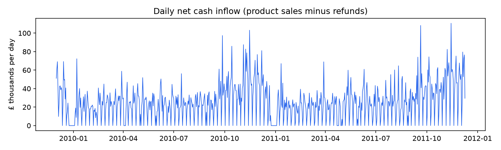
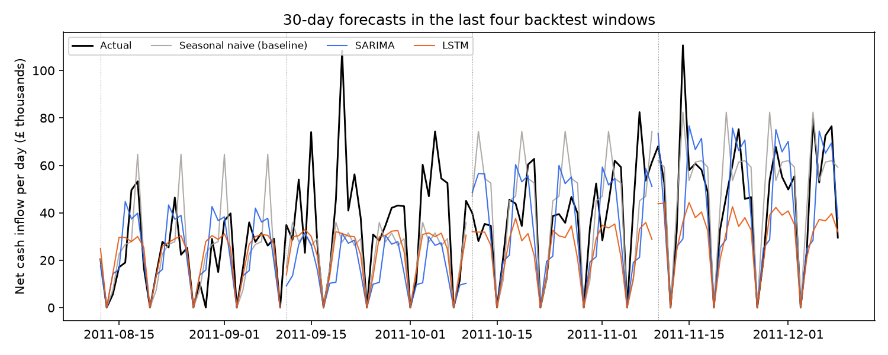

# Cash Flow Forecasting

[](https://github.com/shubham-italiya/cash-flow-forecasting/actions/workflows/ci.yml)


Forecasts the **next 30 days of daily cash inflow** for a small UK online retailer, from about one million real
transactions (2009-2011). Compares a seasonal-naive baseline, **SARIMA** and an **LSTM** (TensorFlow/Keras)
in a rolling backtest, and packages the winning model for **AWS Lambda** with model files versioned in **S3**.



## Results

Rolling backtest: six 30-day windows over the last six months of data (June to December 2011, including the
November peak). Every model is refitted on the data before each window and never sees the window itself.

| Model | Mean daily MAE | vs baseline | Error on the 30-day total |
|---|---|---|---|
| Seasonal naive: same weekday last week (baseline) | £11,871 | - | 20.7% |
| SARIMA (2,1,2)(0,1,1)<sub>7</sub> on log cash | £12,787 | +8% | **19.4%** |
| **LSTM**, 56-day input, 30-day direct output | **£11,673** | **-2%** | 24.8% |



**What this shows**

- **The LSTM had the lowest daily error**, 9% below SARIMA, but only **2% better than the naive baseline**.
  Daily cash for this business is noisy (the median order is £301, but 85 single orders were over £10,000),
  and "same day last week" already captures the strongest pattern: the weekly cycle with Saturdays closed.
- **SARIMA lost to the baseline on daily MAE** but was best on the 30-day total, which is the number a cash-flow
  plan actually uses. Which model is "best" depends on the business question.
- **All models under-forecast the November peak** (right side of the chart): with less than two years of
  history none of them learns yearly seasonality. That is the clearest next step (below).
- Lesson: always benchmark against a naive forecast. Without it, a deep-learning model can look impressive
  while adding very little.

## Method

1. **Data cleaning** ([`data.py`](src/cashflow/data.py)). Product lines only (stock codes starting with five digits);
   refunds (cancelled invoices, negative quantities) are subtracted; postage, fees and accounting adjustments are
   left out. Days without trading are 0. Result: 739 days, mean £25,611 per day.
2. **Stationarity** ([`analysis.py`](src/cashflow/analysis.py), [`reports/stationarity.md`](reports/stationarity.md)).
   Augmented Dickey-Fuller tests: the raw series is not stationary (p = 0.16); the log series is (p = 0.0001),
   and so is the weekly-differenced log series (p < 0.001). SARIMA works on log cash with a weekly difference
   (D = 1) to remove the weekly cycle and a regular difference (d = 1) for the slow trend.
3. **SARIMA order** chosen by AIC on the data **before** the first backtest window only, so the test windows
   are never used to choose anything.
4. **LSTM** ([`models.py`](src/cashflow/models.py)): reads the last 56 days (standardised log cash plus a one-hot
   weekday) and outputs all 30 future days at once; early stopping on the most recent 15% of training windows;
   fixed seeds and deterministic ops, so the results above are reproducible.
5. **Backtest** ([`backtest.py`](src/cashflow/backtest.py)): rolling origin, 6 folds x 30 days. Metrics: mean
   absolute error per day (£) and absolute percentage error of the 30-day total.
6. **Serving** ([`deploy/`](deploy)): the best model is refitted on all data and saved. A Lambda handler loads it
   from S3 (or a local folder in tests) and returns a 1-30 day forecast as JSON. Container image + AWS SAM template
   with a versioned S3 bucket. The handler has its own tests; the stack itself is not deployed from this repo.

## Run it

```bash
pip install -e ".[dev]"
make data    # downloads the dataset (~45 MB) and builds data/daily_net_cash.csv
make train   # ADF tests + backtest + saves the best model to artifacts/model/ (~3 minutes on a laptop CPU)
make test    # 14 tests: data cleaning, models, save/load, backtest, Lambda handler
```

## Project structure

```
src/cashflow/data.py       download, clean, build the daily series
src/cashflow/analysis.py   ADF stationarity tests
src/cashflow/models.py     SeasonalNaive, Sarima, LstmForecaster (same fit/predict/save/load interface)
src/cashflow/backtest.py   rolling-origin evaluation
src/cashflow/train.py      the experiment; writes reports/ and artifacts/model/
deploy/                    Lambda handler, Dockerfile, SAM template, deployment guide
tests/                     pytest suite (runs in CI on every push)
```

## Next steps

- **Yearly seasonality**: add last year's value for the same week as an input (to the LSTM) or as Fourier terms
  (to SARIMA), to catch the November peak.
- **Prediction intervals** instead of single numbers: a cash plan needs a range.
- **Holiday calendar** for the Christmas shutdown.

## Data

Chen, D. (2019). *Online Retail II* [Dataset]. UCI Machine Learning Repository. https://doi.org/10.24432/C5CG6D,
licensed [CC BY 4.0](https://creativecommons.org/licenses/by/4.0/). Downloaded by `make data`; not stored here.

## Background

This is a 2026 rebuild of a personal forecasting project I started in 2025. The original code and data were lost,
so I rebuilt it with a public dataset. All numbers on this page come from this rebuild.
